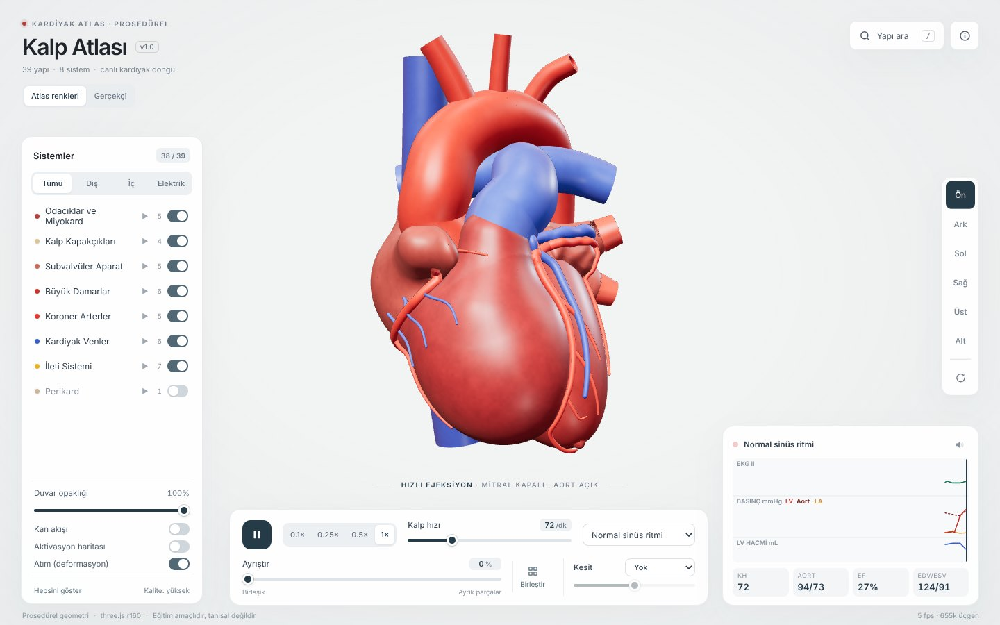
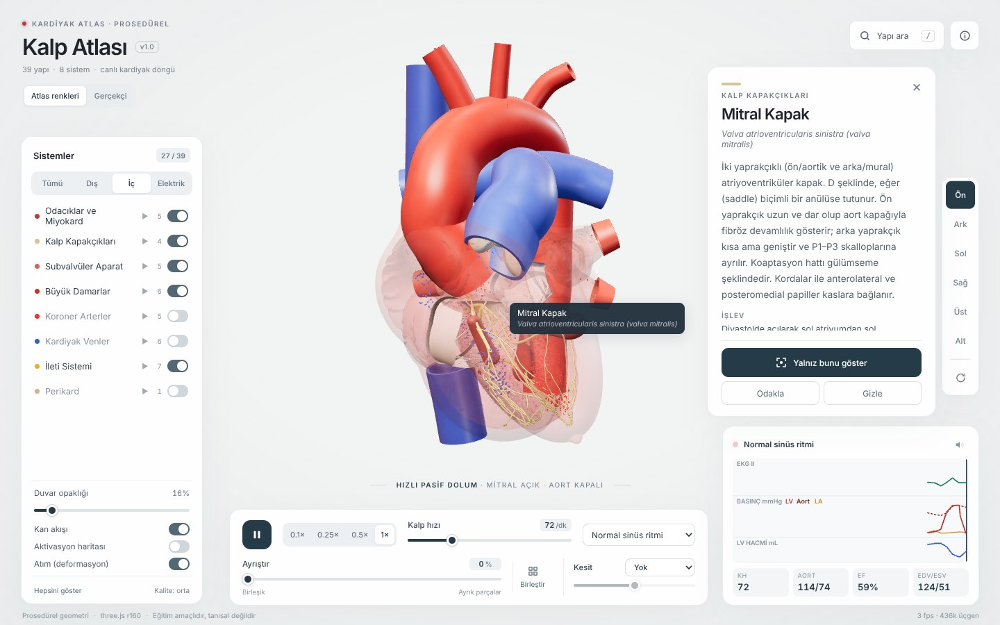

# Kalp Atlası — prosedürel, animasyonlu three.js kalp anatomisi kütüphanesi

Hiçbir dış model dosyası kullanmadan, kalbin tüm yapılarını tarayıcıda **sıfırdan üreten**, parçaları
ayrı ayrı kullanılabilen ama aynı koordinat sisteminde **kusursuz birleşen** ve gerçek bir kardiyak
döngüyle **atan** bir three.js kütüphanesi + human-atlas tarzı stüdyo arayüzü.





```
heart-atlas/
├── index.html · styles.css · app.js     ← stüdyo arayüzü (demo)
└── src/
    ├── index.js                          ← public API
    ├── HeartAnatomy.js                   ← orkestratör: parçalar, ayrıştırma, kesit, seçim, animasyon
    ├── anatomy/
    │   ├── landmarks.js                  ← vücut koordinat sistemi + ölçülere dayalı anatomik referans noktaları
    │   ├── fields.js                     ← odacıkların SDF tanımları (duvar, boşluk, orifisler, septumlar)
    │   └── catalog.js                    ← 39 yapı: TR / EN / Latince ad, açıklama, işlev, klinik not, renkler
    ├── core/
    │   ├── sdf.js                        ← SDF primitifleri, yumuşak birleşim, Perlin/ridged gürültü
    │   ├── surfaceNets.js                ← dar bantlı Surface Nets örücü (Newton projeksiyonlu)
    │   ├── geometry.js                   ← değişken yarıçaplı et kalınlıklı tüp, paralel taşıma çerçeveleri
    │   └── heartMaterial.js              ← ortak GPU deformasyon alanı + doku, yağ, aktivasyon, GPU picking
    ├── parts/
    │   ├── chambers.js                   ← LV, septum, RV, LA, RA, papiller kaslar, moderatör bant
    │   ├── valves.js                     ← animasyonlu mitral, triküspit, aort, pulmoner kapaklar
    │   ├── chordae.js                    ← dallanan korda tendinealar (yaprakçık ↔ papiller kas)
    │   ├── vessels.js                    ← aort (Valsalva sinüsleri), pulmoner trunkus, VCS/VCI, pulmoner venler
    │   ├── coronaries.js                 ← oluklara otomatik yerleşen koroner arterler ve kardiyak venler
    │   ├── conduction.js                 ← SA/AV düğüm, internodal yollar, His, dallar, Purkinje ağı
    │   └── pericardium.js                ← yarı saydam perikard kesesi
    └── sim/
        ├── CardiacCycle.js               ← elektrik + mekanik + hemodinamik + EKG motoru
        └── BloodFlow.js                  ← akıma bağlı kan partikülleri
```

## Çalıştırma

Derleme adımı yoktur; ES modülleri ve import map kullanılır (three.js r160 CDN'den yüklenir).
Herhangi bir statik sunucu yeterlidir:

```bash
cd heart-atlas
npx serve .            # veya: python3 -m http.server 8080
```

`http://localhost:3000` (veya 8080) adresini açın. URL parametreleri:
`?q=low|medium|high|ultra` (ağ çözünürlüğü), `?palette=real`, `?rhythm=afib|avb1|avb3|vf`, `?hr=110`,
`?noassembly` (açılıştaki birleştirme animasyonunu atla).

## Parçalar (39 yapı, 8 sistem)

| Sistem | Parçalar |
|---|---|
| Odacıklar ve miyokard | sol ventrikül serbest duvarı, interventriküler septum, sağ ventrikül (infundibulum dahil), sol atriyum (sol aurikula), sağ atriyum (sağ aurikula, fossa ovalis) |
| Kapakçıklar | mitral (ön/arka yaprakçık, P1–P3 skalloplar), triküspit (ön/arka/septal), aort (sağ/sol/non-koroner kapakçıklar), pulmoner |
| Subvalvüler aparat | LV papiller kasları (anterolateral, posteromedial), RV papiller kasları (ön, arka, septal), mitral ve triküspit kordaları, moderatör bant |
| Büyük damarlar | aorta (kök, Valsalva sinüsleri, arkus, 3 arkus dalı, inen aorta), pulmoner trunkus + sağ/sol PA, VCS, VCI, 4 pulmoner ven, ligamentum arteriosum |
| Koroner arterler | sol ana koroner, LAD (+3 diyagonal), sirkumfleks (+2 obtus marjinal), RCA (+konus, SA düğüm arteri, akut marjinal, posterolateral), PDA |
| Kardiyak venler | koroner sinüs, büyük / orta / küçük kardiyak ven, LV arka veni + Marshall veni, ön kardiyak venler |
| İleti sistemi | SA düğüm, internodal yollar + Bachmann demeti, AV düğüm (Koch üçgeni), His demeti, sol dal (ön/arka/septal fasikül), sağ dal (moderatör bant içinden), Purkinje ağı |
| Perikard | perikard kesesi (varsayılan gizli) |

### Anatomik modelleme ilkeleri

- **Ortak çerçeve:** +X hastanın solu, +Y süperior, +Z anterior; birim santimetre. Her parça bu çerçevede
  üretilir, bu yüzden herhangi bir alt küme kendi başına kullanılabilir ve yan yana konduğunda tam oturur.
- **Ölçülere dayalı referanslar:** LV uzun ekseni ≈8 cm (apekse doğru öne-aşağı-sola), LV duvarı ≈0,95 cm,
  RV duvarı ≈0,38 cm, atriyal duvar ≈0,27 cm, anülüsler (mitral 3,1×2,4, triküspit 3,5, aort 2,3, pulmoner 2,4 cm),
  pulmoner kapak aortun önünde-üstünde-solunda, aort–mitral fibröz devamlılığı, triküspit septal yaprakçığı
  mitralden ≈1 cm daha apikal.
- **Topografik ilişkiler SDF ile kurulur:** septum LV'ye aittir ve RV onu hilal şeklinde sarar; interatriyal
  septum LA'ya aittir ve fossa ovalis RA tarafından görülür; aort kökü atriyumlara gömülür (torus aorticus);
  her damar ve kapak gerçek bir lümene/orifise açılır (kesit görünümlerinde içerisi görülebilir).
- **Koroner damarlar oluklarda bulunur, elle yerleştirilmez:** interventriküler oluklar RV hilalinin LV yüzeyindeki
  kenarlarından, AV oluk taban çevresinde epikardiyal zarf örneklenerek otomatik çıkarılır; damarlar yüzeye
  projekte edilip yumuşatılır (sağ dominant dolaşım).
- **Yüzey detayları:** LV'de ince, RV'de kaba trabeküller (düz infundibulum), RA'da crista terminalis'ten çıkan
  pektinat kaslar, LA'da yalnız aurikulada pektinat kaslar, kenarı tırtıklı sol aurikula, gerçekçi
  palette oluklar boyunca lobüler epikardiyal yağ.

> **Doğruluk notu:** Model, erişkin referans ölçülerine ve topografik ilişkilere sadık kalan idealize bir
> prosedürel modeldir; bir hasta taraması (CT/MR) değildir ve bireysel varyasyonları içermez.
> Eğitim amaçlıdır, tanı veya cerrahi planlama için uygun değildir.

## Animasyon (statik değil)

Tek bir `CardiacCycle` motoru her şeyi sürer:

- **Elektrik:** iki ayrı saat (P ve QRS) → normal sinüs ritmi (solunumsal sinüs aritmisi dahil), atriyal
  fibrilasyon, 1. derece AV blok, 3. derece (tam) AV blok, ventriküler fibrilasyon. Sentetik EKG (DII).
- **Mekanik (Wiggers):** MVC = QRS + 45 ms → izovolümetrik kasılma → ejeksiyon (LVET = 413 − 1,7·KH,
  12x(1−x)² akım profili) → izovolümetrik gevşeme → hızlı dolum (E) → diyastaz → atriyal sistol (A).
- **Hemodinamik:** iki elemanlı Windkessel aort + barorefleks, EDPVR, LA a/c/v dalgaları →
  normal ritimde ≈120/80 mmHg, EDV ≈120 mL, ESV ≈50 mL, EF ≈%58.
- **GPU deformasyon alanı** (`heartMaterial.js`) tüm parçalara aynı anda uygulanır:
  AV düzleminin apekse inişi (MAPSE/TAPSE), miyokard sıkıştırılamazlığına dayalı duvar kalınlaşması
  (r'² = r² − c), sol ventrikül torsiyonu, atriyal kasılma, arter/ven basınç dalgasıyla genişleme, AF/VF'de titreme.
- **Kapakçıklar:** her karede yeniden hesaplanır — AV kapaklarda eğer biçimli anülüs, koaptasyon hattı,
  E/A çift açılması ve diyastazda yarı kapanma; semilunar kapaklarda taç biçimli menteşe, kapanınca "Y"
  (Mercedes) koaptasyonu, açılınca üçgen orifis.
- **Kordalar** papiller kas başları ile hareketli yaprakçık kenarları arasında her karede yeniden gerilir;
  parçalar ayrıştırıldığında da bağlı kalıp ip gibi uzar.
- **Aktivasyon haritası:** her tepe noktası bir aktivasyon zamanı taşır (SA düğümden atriyal yayılım,
  PR'ye göre uzayan AV gecikmesi, His → dallar → Purkinje, septum/apeksten tabana ventriküler aktivasyon);
  depolarizasyon cephesi doku üzerinde ışıldar.
- **Kan akışı:** venöz dönüş, AV kapak dolumu ve ejeksiyonla hızlanan/duran partiküller (oksijenli kırmızı,
  oksijensiz mavi).
- **Birleştirme animasyonu:** parçalar sistem sistem uçarak yerine oturur.

## Kütüphane API'si

```js
import * as THREE from 'three';
import { HeartAnatomy, PARTS, SYSTEMS } from './src/index.js';

const heart = new HeartAnatomy({ quality: 'high', palette: 'atlas', heartRate: 72, rhythm: 'nsr' });
await heart.build((progress, label) => console.log(progress, label));
scene.add(heart.root);                      // birimler: cm
renderer.localClippingEnabled = true;       // kesit görünümleri için

function loop(dtMs) { heart.update(dtMs); renderer.render(scene, camera); }
```

Yalnızca bazı parçaları üretmek (ör. kapak eğitimi için):

```js
const valvesOnly = new HeartAnatomy({ parts: ['mitralValve', 'chordaeLeft', 'lvPapillary', 'leftVentricle'] });
await valvesOnly.build();
```

| Yöntem | Açıklama |
|---|---|
| `heart.parts.get(id)` | `{ id, meta, group, meshes, materials, center, explodeDir, … }` — her parça bağımsız bir `THREE.Group` |
| `setExplode(0…1, animate?)` / `playAssembly(ms)` | parçaları ayrıştır / sinematik birleştirme |
| `setSystemVisible(sys, bool)` · `setPartVisible(id, bool)` · `isolate(id \| null)` | görünürlük |
| `setSection(mode, offsetCm)` | `none · fourChamber · longAxis · shortAxis · coronal · sagittal` |
| `setWallOpacity(0…1)` | hayalet görünüm (duvarlar + büyük damarlar) |
| `setPalette('atlas' \| 'real')` | didaktik veya diseksiyon renkleri (epikardiyal yağ dahil) |
| `setElectricView(bool)` · `setFlowVisible(bool)` · `setDeformation(bool)` | katmanlar |
| `select(id)` · `hover(id)` | vurgulama |
| `pick(renderer, scene, camera, x, y)` | GPU kimlik geçişiyle piksel‑doğru seçim (atım sırasında da) |
| `heart.cycle` | `setHeartRate(bpm)`, `setRhythm(r)`, `speed`, `paused`, `state`, `history`, `on('S1' \| 'S2' \| 'phase', fn)`, `ecgAt(t)` |
| `heart.valves.mitral.update(opening)` | kapakları elle sürmek için (0 kapalı … 1 açık) |

`heart.cycle.state` her karede şunları verir: `phase`, `mitral/tricuspid/aortic/pulmonary` açıklığı,
`lvVolume`, `lvPressure`, `aoPressure`, `laPressure`, `ecg`, `vContraction`, `aContraction`, `heartRate` …

Düşük seviyeli araçlar da dışa aktarılır: `createLandmarks`, `createFields`, `meshSDF`, `sdf.*`,
`createHeartMaterial`, `LeafletValve`, `Chordae`, `CardiacCycle`, `BloodFlow`.

## Arayüz

human-atlas'tan esinlenen açık renkli stüdyo düzeni: sol tarafta sistem listesi (anahtarlar, parça bazında
göster/gizle), hazır görünümler (Tümü / Dış / İç / Elektrik), sağda görünüm düğmeleri, altta oynatma
(0,1×–1× hız, kalp hızı, ritim), ayrıştırma ve kesit kontrolleri; sağ altta EKG / basınç / hacim monitörü
ve isteğe bağlı sentezlenmiş S1/S2 kalp sesleri; yapıya tıklayınca detay paneli (yalnız bunu göster, odakla, gizle).

Klavye: `Boşluk` oynat/duraklat · `/` ara · `E` ayrıştır · `B` birleştir · `1–6` görünümler · `R` döndür · `F` odakla · `Esc` kapat.

## Lisans / kaynak

Tüm geometri ve kod bu depoda sıfırdan yazılmıştır; harici anatomi verisi kullanılmaz.
Arayüz yerleşimi [ashemag/human-atlas](https://github.com/ashemag/human-atlas) projesinden esinlenmiştir.
